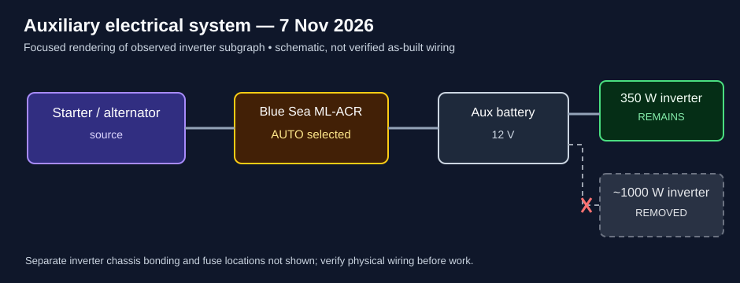

# Inverter removal — 7 November 2026

**Completed:** Removed the larger (~1,000 W) inverter and its battery cables from the existing auxiliary 12 V system. The smaller (~350 W) inverter remains connected and powered on in a brief test. No photographs taken.

## Procedure used (repeat only after checking the actual wiring)

1. Switch off inverters and other loads. Shut down the diesel heater normally and wait for its cooling fan to stop.
2. With engine and charging sources off, set the Blue Sea ML-ACR to **LOCK OFF**.
3. Disconnect the auxiliary battery **negative terminal first**.
4. Remove the unwanted inverter's **positive** ring terminal from the battery; tighten the remaining positive connections.
5. Remove its **negative** ring terminal from the disconnected negative connector; tighten the remaining negative connections.
6. Remove the inverter's dedicated chassis-bonding wire from the body connection **only after verifying it is not shared**. Remove the inverter and its cables; keep the remaining inverter's chassis bond.
7. Verify all unused cables are removed or individually insulated and secured, and all remaining connections are secure.
8. Reconnect and tighten the auxiliary battery negative terminal **last**.
9. Check for abnormal heating, smells, or sounds; briefly test the remaining inverter and switch it off.
10. Return the ML-ACR to **AUTO** (middle selector position, not manual ON).

**Observed:** A tiny, momentary spark occurred on negative reconnection; no other abnormal behavior observed. The smaller inverter powered up.

## Wiring diagram

[Open the SVG separately](./inverter-removal-subgraph.svg). This is a simplified view of the observed subgraph, not a full export of the draw.io plan.

Existing editable [12 V electrical diagram](../../electronics_victron_12v.drawio) — **historical/planning drawing, not an as-built verification**. Its observed old-auxiliary-system block now marks the ~1,000 W inverter **removed** in grey and the ~350 W inverter **remaining**. The broader topology is still a planning/observational diagram, not a verified as-built schematic. The removed inverter had separate positive, negative, and chassis-bond connections.

## Checks before the next removal

- Use a working meter to verify isolation and absence of other charging feeds before touching conductors. Battery positive remains live relative to battery negative/chassis even with the negative lead disconnected.
- Confirm the smaller inverter's positive cable fuse and the ML-ACR's actual automatic combine/separate behavior.
- Trace the chassis bond and the wiring before removing the second inverter; do not assume the drawing captures all connections.
- The relay may previously have been left in manual ON; this was **not verified**.
