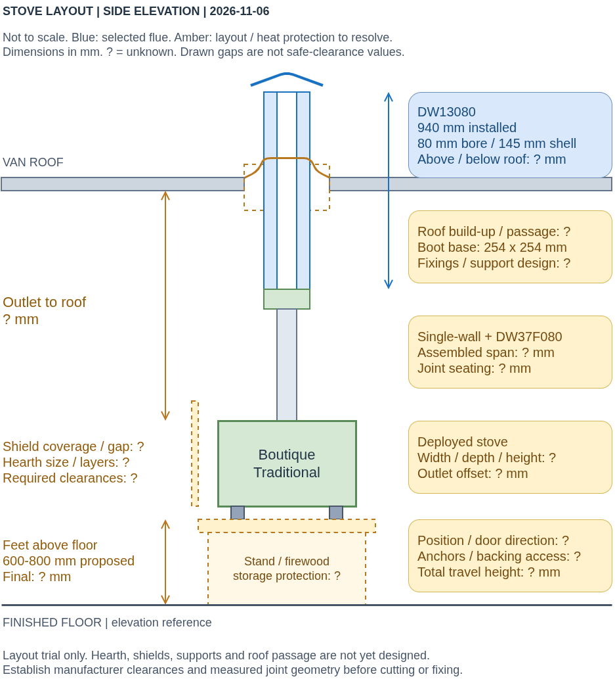

# Wood-Stove Installation

**Working procedure, updated 2026-11-06.** Main components ordered; installation
not recorded as completed. Start at the first unfinished step. The sequence is
defined below; final dimensions and construction methods remain to be filled in.

::: info Next action

Dry-fit the delivered flue parts and trial the stove position. Fill in the
unknown dimensions in the [layout picture](#measure-and-fix-the-layout)
before choosing the remaining mounting and heat-protection materials.
:::

## Current Build Status

The proposed stove-feet elevation is **600-800 mm above the finished floor**,
near the side door. Final height, hearth stack, firewood storage protection,
shield coverage/layers, ventilation and attachments remain unresolved.
No completed installation or commissioning is recorded.

[Shopping list](shopping_list_boutique.md) covers parts, consumables and tools.
[Build story](story/index.md) contains the narrative.
[Requirements and checks](#requirements-and-checks) collects the existing
installation constraints in one place.

## Chosen Assembly

**Boutique Traditional -> supplied nominal 80 mm single-wall flue ->
DW37F080 connector -> DW13080 insulated section -> DW1076080 terminal/hood.**

The DW-FU section has an 80 mm bore, 145 mm outer shell and **940 mm effective
installed length**. Master Flash Standard **#4 / SQ402RA** is the selected
weather boot: 69-177 mm pipe range and 254 x 254 mm base.

## Decisions And Trade-offs

| Decision | Reason and accepted trade-off | Still to settle |
| --- | --- | --- |
| Boutique Traditional | Broad cooktop, large front window and rigid body; clean 1-2 kW operation is unproven. | Actual operating behaviour |
| Included single-wall flue and separate DW37F080 | Use supplied pipe; nominal-size fit risk accepted when ordering the connector. | Delivered joint geometry and seating |
| 1000 mm insulated element, 940 mm installed | More indoor/outdoor layout margin than the 500 mm option; extra length can extend downwards without raising the top. | Measured split at the roof |
| Low exterior chimney, retained while driving | Avoid a tall removable exterior assembly. | Terminal position, supports and travel retention |
| Stove mounting elevation open | Raising the stove changes loading/cooking ergonomics and reduces outlet-to-terminal rise at a fixed chimney top. | Height after a physical layout trial |
| Integrated Jeremias terminal/hood | Completes the insulated terminal; the cheaper retrofit hood alone did not. | Any additional spark screen and its cleaning arrangement |
| Separate silicone #4 boot | Fits the planned 145 mm shell; ordered separately from the chimney. | Base fit, sealant and fixing arrangement |

The [research notes](research.md) retain source evidence and alternatives.
The [shopping list](shopping_list_boutique.md) records actual order amounts
and remaining purchases.

## 1. Measure And Fix The Layout

Not to scale. Known component dimensions are labelled; **?** marks measurements
or design still open. The 600-800 mm elevation is a proposal, not a fixed dimension.
[Open full-size picture](../_static/figures/stove-layout-measurements.png) ·
[Editable picture and schematic reference](figures.md).

1. **Dry-fit the flue:** assemble the supplied pipe, connector, insulated section
   and terminal. Measure joint seating and effective lengths, check
   [joint bands](shopping_list_boutique.md#item:jeremias_dw13080), and identify
   any extra pipe/connector needs.
2. **Trial the position:** measure the deployed stove and outlet offset.
   Choose orientation and feet elevation from the finished floor; mark the roof
   route and compare it with the rack, fan and windows.
3. **Complete the drawing:** fill in the unknown dimensions, hearth/shields,
   airspaces, stand, restraints, chimney supports and backing/fastener access.
   Specify roof-passage protection, boot fixings/sealant and the shared
   [replacement-air inlet](../floor/replacement_air.md).
4. **Complete the kit:** enter selected materials and quantities in the
   [shopping list](shopping_list_boutique.md). Check owned/borrowed tools and
   included hardware before ordering.

Resolve the layout and [requirements](#requirements-and-checks) before permanent
mounting or a roof cut. Preserve underfloor attachment access during
[floor work](../floor/index.md).

## 2. Fit The Hearth, Shields And Stove Mounting

Materials: [hearth](shopping_list_boutique.md#item:stove_hearth),
[body shields](shopping_list_boutique.md#item:stove_body_wall_shields),
[flue shields](shopping_list_boutique.md#item:stove_flue_wall_shields),
[stand/restraints](shopping_list_boutique.md#item:stove_restraints) and
[mounting fasteners](shopping_list_boutique.md#item:stove_mounting_fasteners).

1. Build the specified hearth/platform and shields to the measured layout.
2. Fit the backing plates and stove restraints; position and secure the stove.
3. Recheck the actual outlet position against the marked roof route.

## 3. Install The Roof Passage And Chimney

Materials: [passage protection](shopping_list_boutique.md#item:stove_roof_passage),
[chimney supports](shopping_list_boutique.md#item:stove_chimney_supports),
[Master Flash boot](shopping_list_boutique.md#item:master_flash_sq402ra),
[boot fixings](shopping_list_boutique.md#item:stove_boot_fixings) and
[sealant](shopping_list_boutique.md#item:stove_boot_sealant).

1. Dry-fit the complete route in the final stove position.
2. Transfer the specified penetration and fixing pattern to the roof.
3. Cut, deburr and protect the exposed steel using the selected coating process.
4. Fit the specified passage protection and structural supports, then assemble
   the flue, connector, insulated element and terminal to the system instructions.
5. Fit the Master Flash boot and its selected fixings/sealant. After curing,
   check for water ingress; record joint seating, indoor/outdoor split and
   overall travel height.

## Requirements And Checks

- **Heat protection:** establish Boutique-specific clearances, hearth/shields,
  storage protection and airspaces. The weather boot is not a firestop or support.
- **Flue:** verify compatible joints, seating, direction, sealing and temperature
  ratings. Required chimney height and terminal position remain unconfirmed.
- **Mounting/travel:** anchor stove and chimney to vehicle structure, allow thermal
  movement, and resolve road retention. Check total height against Finland's
  4.40 m limit and route clearances; confirm vehicle approval requirements.
- **Weather seal:** confirm roof/boot/sealant compatibility, application and cure
  conditions, then water-test. The [sealant record](shopping_list_boutique.md#item:stove_boot_sealant)
  links its technical sheet.
- **Air/safety equipment:** provide replacement air, CO/smoke alarms and an
  extinguisher. No MaxxFan extraction with a live stove unless depressurization
  and smoke spillage are designed/tested for.
- **First firing:** follow applicable instructions and establish acceptance
  checks for draft, smoke spillage and nearby surface temperatures before use.
- **Maintenance:** retain cleaning access, inspect early use, and burn dry wood
  without smouldering. Close a cold-stove closure only when fully cold.

Sources: [technical evidence](research.md#mounting-and-chimney-height),
[Boutique product/instructions source](https://boutiquecamping.com/en-eu/products/traditional-wood-burning-stove?view=v2),
[Jeremias DW-FU installation manual](https://www.kamin-store24.de/mediafiles/PDF/Jeremias_DE_Montageanleitung_DW-FU.pdf)
and [Master Flash reference](https://master-flash.eu/master-flash-silicone-2/master-flash-standard/).

## References And Progress

Add installation reference videos and dated progress photos
(`docs/blog/wood_stove/images/`) as work proceeds. Record the actual method
beside each completed step; keep the narrative in the [build story](story/index.md).
